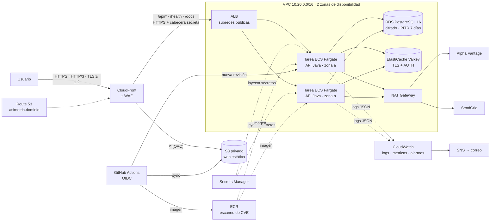

# Despliegue en AWS

Infraestructura como código en [`infra/aws`](../infra/aws) (Terraform ≥ 1.10, proveedor AWS 6.x). Despliegue continuo con [`.github/workflows/deploy-aws.yml`](../.github/workflows/deploy-aws.yml). Todo el diseño parte de los RNF del documento del Sprint 2 y de las características de la norma ISO/IEC 25010.

> **Procedimiento paso a paso** (fases, responsables, configuración y verificación de cada servicio, reversión y desmantelamiento): [PLAN-DESPLIEGUE-AWS.md](PLAN-DESPLIEGUE-AWS.md).

> La ruta con un solo servidor (Docker Compose + Caddy, [DESPLIEGUE.md](DESPLIEGUE.md)) sigue disponible y cuesta ~10× menos. AWS se justifica cuando se necesita alta disponibilidad entre zonas, autoescalado y servicios gestionados (copias, parches, certificados).

## 1. Arquitectura



Un único dominio sirve la web y la API (mismo origen, sin CORS), como Nginx en local. El ALB solo acepta tráfico de las IP de CloudFront **y** con la cabecera secreta `X-Origen-Verificado`. Así nadie se salta el WAF yendo directo al balanceador; el acceso directo responde 403.

## 2. Recursos ↔ ISO/IEC 25010

Los costos son estimaciones mensuales *on-demand* en `us-east-1` (precios públicos de AWS a 2025) para la configuración por defecto: 2 tareas de 0,5 vCPU / 1 GB, tráfico académico (< 50 GB/mes). Confírmalos en la [calculadora de AWS](https://calculator.aws/) antes de aplicar.

| Característica (subcaracterística) | Recurso | Dónde (`infra/aws`) | Objetivo | Costo/mes |
|---|---|---|---|---|
| **Fiabilidad** (disponibilidad, tolerancia a fallos) | ECS Fargate: mínimo 2 tareas en 2 zonas, *circuit breaker* de despliegue con rollback, `minimum_healthy_percent = 100` | `computo.tf` | Sobrevivir a la caída de una tarea o de una zona; desplegar sin pérdida de capacidad; revertir sola una versión defectuosa (RNF-05: SLA 99,5 %) | ~36 USD |
| Fiabilidad (disponibilidad) · Eficiencia | ALB con health check en `/actuator/health/readiness`, `deregistration_delay` 30 s | `computo.tf` | Enviar tráfico solo a tareas listas; drenar conexiones al desplegar | ~22 USD |
| Fiabilidad (recuperabilidad) | RDS: copias automáticas 7 días con restauración a un punto en el tiempo, *snapshot* final, `deletion_protection`, almacenamiento autoexpandible (gp3, 20 → 100 GB). Opcional `bd_multi_az` | `datos.tf` | RPO ≈ 5 min, RTO < 30 min sin administrar backups; failover en ~60 s con Multi-AZ | ~14 USD (+14 con Multi-AZ) |
| Fiabilidad (tolerancia a fallos) | ElastiCache Valkey (estado compartido: circuito, cuotas, bloqueo de login, cotizaciones). Opcional `cache_alta_disponibilidad` | `datos.tf` | Que todas las tareas vean el mismo circuito y los mismos contadores. Si cae, la API sigue con PostgreSQL (`AlmacenRedis`, RNF-06) | ~9 USD (+9 con réplica) |
| Fiabilidad (madurez) | Health check de Route 53 sobre `/health` cada 30 s desde varias regiones + alarma | `observabilidad.tf` | Monitoreo externo que exige RNF-05 («sondeado cada 60 s») | ~2 USD |
| **Eficiencia de desempeño** (capacidad) | Autoescalado 2 → 6 tareas por CPU (60 %) y por peticiones por tarea | `computo.tf` | Absorber picos (apertura del mercado) y reducir costo de madrugada (RNF-01: P95 ≤ 2 s) | Incluido (cada tarea extra ~18 USD prorrateado) |
| Eficiencia (comportamiento temporal) | CloudFront (HTTP/3, compresión Brotli/gzip, caché de la web en el borde), `PriceClass_100` | `borde.tf` | La web estática no toca la VPC; menor latencia | ~0 USD (1 TB/mes gratis) |
| Eficiencia (utilización de recursos) | Endpoint *gateway* de S3 | `red.tf` | Las capas de imagen de ECR no pasan (ni pagan) por el NAT | 0 USD |
| **Seguridad** (confidencialidad) | Subredes privadas para API, BD y caché; grupos de seguridad encadenados (CloudFront → ALB → API → BD/caché) | `red.tf` | Nada salvo el ALB es alcanzable desde Internet, y el ALB solo desde CloudFront | 0 USD |
| Seguridad (confidencialidad) | Cifrado en reposo (RDS, Valkey, S3, ECR) y en tránsito: TLS ≥ 1.2 en el borde, `rds.force_ssl` + `sslmode=verify-full` con la CA de RDS, TLS en Valkey, ALB `ELBSecurityPolicy-TLS13-1-2-2021-06` | `datos.tf`, `borde.tf`, `computo.tf`, `apps/api-java/Dockerfile` | RNF-03; ningún dato viaja en claro, ni dentro de la VPC | 0 USD |
| Seguridad (confidencialidad) | Secrets Manager: contraseñas de BD/caché y firma JWT generadas por Terraform; claves de Alpha Vantage y SendGrid cargadas aparte (no quedan en el estado de Terraform) | `datos.tf` | Ningún secreto en la imagen, en Git ni en variables de CI | ~1 USD |
| Seguridad (integridad, autenticidad) | WAF: reglas gestionadas (OWASP comunes, entradas maliciosas, SQLi, reputación IP) + límites por IP (100/5 min en `/auth`, 3 000/5 min general) | `borde.tf` | Frenar inyección, *bots* y fuerza bruta antes de que consuman cómputo. Complementa `LimiteTasaFiltro` de la API | ~12 USD |
| Seguridad (autenticidad, responsabilidad) | GitHub OIDC: rol con mínimo privilegio, asumible solo desde el entorno `aws-produccion` del repositorio | `github.tf` | Despliegue sin claves de larga duración; cada despliegue queda en CloudTrail | 0 USD |
| Seguridad (integridad) | ECR con etiquetas inmutables y escaneo de CVE al subir; tareas sin root y con sistema de archivos de solo lectura | `computo.tf` | Una etiqueta = una imagen verificable; menor superficie de ataque | ~0,5 USD |
| Seguridad (trazabilidad) · **Mantenibilidad** (analizabilidad) | CloudWatch Logs (JSON, 30 días), Container Insights, 9 alarmas → SNS (5xx, P95 > 2 s, tareas no sanas, sin tareas, memoria, CPU/almacenamiento/conexiones de BD, sitio caído) | `observabilidad.tf` | Detectar y diagnosticar antes que el usuario. La auditoría de negocio (RNF-04, 90 días) sigue en PostgreSQL | ~5 USD |
| **Mantenibilidad** (modificabilidad) · **Portabilidad** (instalabilidad) | Terraform versionado, validado en CI (`fmt`, `validate`), proveedores fijados en `.terraform.lock.hcl`; estado remoto en S3 cifrado con bloqueo | `versions.tf`, `ci.yml` | Entorno reproducible y revisable en *pull requests*; un `terraform apply` levanta todo (RNF-10) | ~0 USD |
| Mantenibilidad (capacidad de prueba) | Pipeline: `mvn verify` (85 pruebas, JaCoCo ≥ 80 %) → imagen → ECS → verificación de `/health` | `.github/workflows` | Ningún cambio llega a producción sin pasar las pruebas (RNF-09) | 0 USD (GitHub Actions) |
| Fiabilidad (recuperabilidad) | Versionado del bucket web (30 días) e imágenes en ECR (últimas 20) | `borde.tf`, `computo.tf` | Volver a una versión anterior de la web o de la API en minutos | ~0 USD |
| — | NAT Gateway (1) + 3 IPv4 públicas (ALB ×2, NAT) | `red.tf` | Salida a Alpha Vantage y SendGrid sin exponer las tareas | ~44 USD |

**Total aproximado: ~150 USD/mes** en la configuración por defecto. Alta disponibilidad completa (`bd_multi_az`, `cache_alta_disponibilidad`, `nat_por_az`): **~210 USD/mes**. Las partidas grandes son las tareas Fargate, el NAT y el ALB. Para una presentación de pocas semanas, aplicar y luego destruir (§7) cuesta unos pocos dólares.

## 3. Requisitos previos (una vez)

1. Cuenta de AWS con acceso de administrador desde la CLI (`aws configure sso` o `aws configure`). Activa MFA en la cuenta raíz y no uses sus credenciales.
2. [Terraform ≥ 1.10](https://developer.hashicorp.com/terraform/install) y [AWS CLI v2](https://docs.aws.amazon.com/cli/latest/userguide/getting-started-install.html).
3. Dominio con **zona alojada pública en Route 53**. Si lo compraste en otro registrador, crea la zona en Route 53 y cambia los servidores de nombres (NS) del dominio por los 4 que te da AWS.
4. Bucket para el estado de Terraform (versionado y sin acceso público; S3 cifra por defecto):

```bash
aws s3api create-bucket --bucket asimetria-tfstate-<id-de-cuenta> --region us-east-1
```

```bash
aws s3api put-bucket-versioning --bucket asimetria-tfstate-<id-de-cuenta> --versioning-configuration Status=Enabled
```

```bash
aws s3api put-public-access-block --bucket asimetria-tfstate-<id-de-cuenta> --public-access-block-configuration BlockPublicAcls=true,IgnorePublicAcls=true,BlockPublicPolicy=true,RestrictPublicBuckets=true
```

## 4. Crear la infraestructura

```bash
cd infra/aws
cp backend.hcl.example backend.hcl            # pon el nombre del bucket
cp terraform.tfvars.example terraform.tfvars  # dominio, zona, repositorio, correo de alarmas
terraform init -backend-config=backend.hcl
terraform plan -out=plan.tfplan
terraform apply plan.tfplan                   # 15–25 min (CloudFront y RDS son los lentos)
```

Si el correo de alarmas está definido, AWS envía **dos** correos de confirmación de SNS (región principal y us-east-1). Hay que aceptarlos.

**Cargar las claves de Alpha Vantage y SendGrid.** Crea un archivo temporal **fuera del repositorio**, cárgalo y bórralo. Nunca pegues las claves en un chat ni en un commit.

```bash
aws secretsmanager put-secret-value --secret-id "$(terraform output -raw secreto_integraciones)" --secret-string file://$HOME/integraciones.json
```

El archivo `integraciones.json` tiene esta forma: `{"ALPHAVANTAGE_API_KEY":"…","SENDGRID_API_KEY":"…"}`. Los valores vacíos dejan la API en modo simulado y con alertas solo en la app. Las tareas leen los secretos al arrancar, así que después de cambiarlos hay que forzar un redespliegue:

```bash
aws ecs update-service --cluster asimetria-produccion --service api --force-new-deployment
```

Para usar datos reales, en `terraform.tfvars` pon `proveedor = "alphavantage"` (el intervalo pasa a 60 s por la cuota gratuita) y vuelve a aplicar.

## 5. Conectar GitHub Actions

1. En GitHub, ve a **Settings → Environments → New environment** y crea `aws-produccion`. Opcional y recomendado: *Required reviewers*, para aprobar cada despliegue.
2. En ese entorno, agrega como **Variables** (no son secretos) los valores de:

```bash
terraform output variables_github
```

   `AWS_ROLE_ARN`, `AWS_REGION`, `ECR_REPOSITORIO`, `ECS_CLUSTER`, `ECS_SERVICIO`, `ECS_FAMILIA`, `BUCKET_WEB`, `CLOUDFRONT_ID` y `DOMINIO_AWS`.
3. **Primer despliegue:** ve a **Actions → Deploy AWS → Run workflow**, o haz push a `main` (corre cuando CI pasa). Hasta ese momento las tareas no arrancan, porque la etiqueta `inicial` no existe en ECR. Es lo esperado.

El flujo hace lo siguiente:

1. Construye la imagen y la sube a ECR con el sha del commit.
2. Registra una nueva revisión de la tarea a partir de la que mantiene Terraform.
3. Hace un *rolling update* y espera a que el servicio quede estable.
4. Sincroniza la web en S3 e invalida CloudFront.
5. Verifica `https://<dominio>/health`.

## 6. Verificación

```bash
curl -sS https://asimetria.midominio.com/health
```

Devuelve `{"estado":"ok","db":true,"cache":true,"cache_tipo":"redis"}`. Si la caché cae, responde `"degradado"` con HTTP 200; si cae la base de datos, HTTP 503.

```bash
curl -sS -o /dev/null -w "%{http_code}\n" https://origen.asimetria.midominio.com/health
```

Tiene que dar `000` (*timeout*) o `403`: el ALB no atiende fuera de CloudFront.

```bash
aws logs tail /ecs/asimetria-produccion/api --follow
```

Muestra los logs JSON de la API.

También conviene revisar dos cosas en la consola:
- **CloudWatch → Alarms**: todas en `OK` tras unos minutos.
- **ECS → Services → api → Deployments**: estado `COMPLETED`.

## 7. Operación

| Tarea | Cómo |
|---|---|
| Ver el estado | `/health`, CloudWatch → Container Insights, alarmas por correo |
| Revertir la API | `aws ecs update-service --cluster asimetria-produccion --service api --task-definition asimetria-produccion-api:<revisión anterior>` (las revisiones se listan con `aws ecs list-task-definitions --family-prefix asimetria-produccion-api`). Si un despliegue no queda sano, ECS revierte solo |
| Revertir la web | Restaurar la versión anterior de los objetos en S3 (versionado 30 días) e invalidar CloudFront |
| Restaurar la base de datos | RDS → *Restore to point in time* (crea una instancia nueva; luego se cambia `DATABASE_URL`) |
| Escalar | `api_min` / `api_max` / `api_cpu` / `api_memoria` en `terraform.tfvars` → `terraform apply` |
| Rotar la firma JWT | `terraform apply -replace=random_password.jwt` y forzar redespliegue (cierra todas las sesiones) |
| Rotar la contraseña de BD | `terraform apply -replace=random_password.bd` y forzar redespliegue (hay un corte breve mientras las tareas se renuevan) |
| Cambiar variables de entorno | Editar `locals.entorno_api` en `computo.tf` → `terraform apply` → ejecutar el flujo de despliegue (toma la última revisión) |
| Apagar todo | Poner `deletion_protection = false` (RDS) y `enable_deletion_protection = false` (ALB), aplicar, y luego `terraform destroy`. RDS deja un *snapshot* final |

## 8. Decisiones y límites conocidos

- **TimescaleDB no existe en RDS.** La migración `V2__SeriesTemporales` lo detecta y crea un índice BRIN. RNF-02 (1 M de filas en < 500 ms) se verificó con TimescaleDB. En RDS, las consultas por activo usan el índice de `(empresa_id, time)`. Si el volumen crece a decenas de millones de filas, conviene particionar por mes o usar Timescale Cloud.
- **Un solo NAT por defecto.** Si su zona cae, la API sigue atendiendo, pero sin llegar a Alpha Vantage ni a SendGrid (circuit breaker abierto, último precio, alertas en la app). `nat_por_az = true` lo resuelve por ~37 USD/mes.
- **La regla de grupo de seguridad con la lista de prefijos de CloudFront** cuenta como ~55 reglas. Si `terraform apply` falla por la cuota de reglas, pide en *Service Quotas* subir «Inbound rules per security group».
- **Sin incluir para mantener el costo bajo:** VPC Flow Logs, logs de acceso del ALB/CloudFront/WAF, GuardDuty, copia de backups entre regiones y llaves KMS propias. Son la siguiente capa si el sistema maneja dinero real; cada una agrega de 1 a 10 USD/mes.
- **Imagen x86_64.** Fargate en ARM (Graviton) es ~20 % más barato. Requiere construir la imagen `linux/arm64` en CI (runner ARM) y cambiar `cpu_architecture`.
