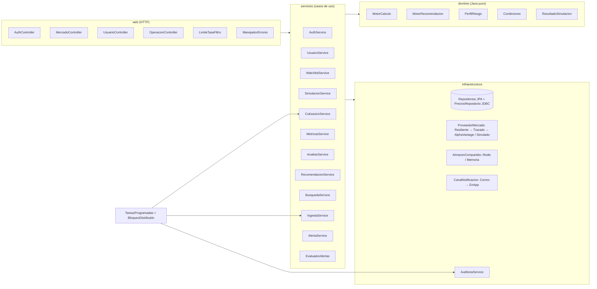
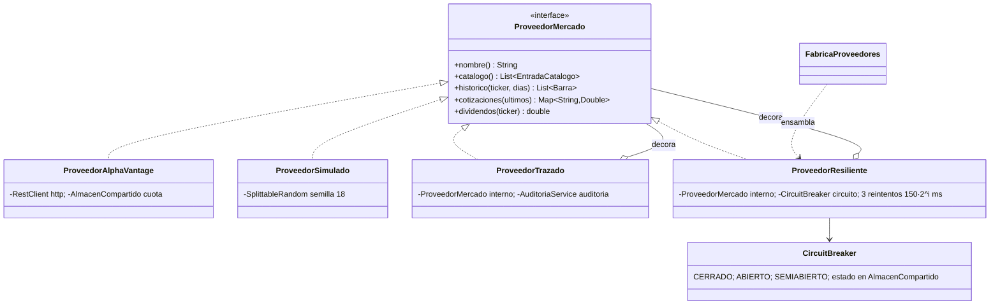
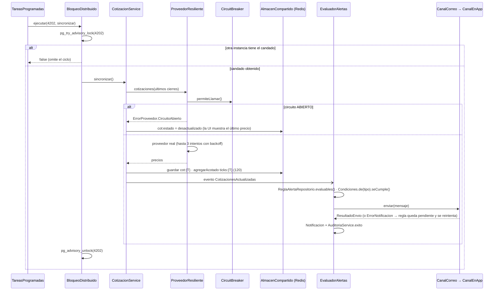
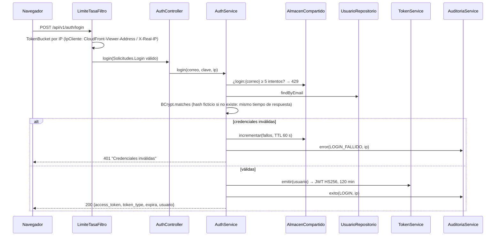
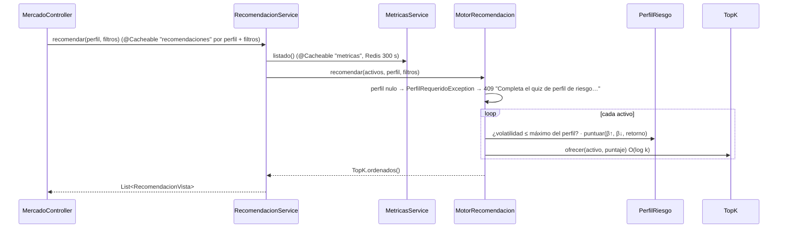

# Backend Java de Asimetría (`apps/api-java`)

Reimplementación del backend en **Java 21 + Spring Boot 4.1**. Mantiene el mismo contrato REST (`/api/v1`, JSON `snake_case`), así que el frontend no cambió. Está preparado para correr con N instancias en la nube (AWS ECS, ver [AWS.md](AWS.md)).

| | |
|---|---|
| Código | 83 clases en 12 paquetes · 3 migraciones Flyway (2 SQL + 1 Java) |
| Pruebas | **85 pruebas** (unitarias + integración con PostgreSQL/TimescaleDB real vía Testcontainers) |
| Cobertura | **95 % de líneas** (JaCoCo). El build falla por debajo del 80 % (RNF-09) |
| Ejecutar pruebas | `cd apps/api-java && mvn verify` (requiere Docker) |
| Ejecutar la pila | `docker compose up -d --build` → http://localhost:8080 (Swagger: `/docs`) |

---

## 1. Arquitectura por capas

Las dependencias van en una sola dirección: `web → servicios → dominio`, y `servicios → persistencia / proveedores`. El **dominio no depende de Spring**: son clases puras, y por eso se prueban sin levantar el contexto.

| Paquete | Responsabilidad |
|---|---|
| `web` | Controladores REST, validación de entrada (`Solicitudes`), errores con contrato `{"detail": …}`, límite de tasa, IP real |
| `usuario`, `mercado`, `alerta` | Casos de uso: orquestan repositorios, proveedores y dominio; transacciones |
| `dominio.*` | Fórmulas (β alcista/bajista, volatilidad, CAPM, drawdown), perfiles, condiciones de alerta, simulación |
| `persistencia` | Entidades JPA, repositorios Spring Data y acceso JDBC por lotes a la serie temporal |
| `mercado.proveedor` | Integración con el proveedor bursátil y su resiliencia |
| `alerta.notificacion` | Envío de alertas (SendGrid y en la app) |
| `comun.estructuras` | Estructuras de datos propias (§3) |
| `comun.almacen` | Estado compartido entre instancias (Redis/ElastiCache, o memoria en pruebas) |
| `tareas` | Tareas periódicas con exclusión mutua entre instancias |
| `config` | Propiedades tipadas y validadas, seguridad (JWT), beans base |

---

## 2. Requerimientos funcionales → código → prueba

| RF | Requerimiento | Endpoint(s) | Clases principales | Pruebas |
|---|---|---|---|---|
| RF-01 | Conexión al proveedor de datos | `GET /mercado/cotizaciones`, `/mercado/intradia/{t}`, `GET /integraciones` | `FabricaProveedores`, `ProveedorAlphaVantage`, `ProveedorSimulado`, `ProveedorResiliente`, `CircuitBreaker`, `CotizacionService` | `ProveedoresTest` (9), `rnf06ProveedorCaido…`, `hu09Ca4…` |
| RF-02 | Ingesta y almacenamiento histórico | `GET /mercado/precios/{t}` | `IngestaService` (carga inicial, cierre diario), `PreciosRepositorio` (lotes, `ON CONFLICT DO NOTHING`), `V2__SeriesTemporales` | `hu02Ca1CincoAniosDeHistoria`, `cierreDiarioGuardaUnaSolaVez…` |
| RF-03 | Motor de β y sensibilidad | `GET /metrics/{t}`, `/metrics/{t}/analisis` | `MotorCalculo.betaAsimetrica`, `MetricasService`, `AnalisisService`, `SerieTemporal.alinear` | `hu03CasoRitechBetaAlcista2YBajista125`, `hu09Ca2Desglose…` |
| RF-04 | Recomendación y filtrado por perfil | `GET /recommendations` | `MotorRecomendacion` (+ `TopK`), `PerfilRiesgo` (Strategy), `RecomendacionService` | `hu04Ca1…`, `hu04Ca3CadaPerfilPriorizaDistinto`, `hu04Ca2Ca4…` |
| RF-05 | Simulador / *backtesting* | `POST/GET /simulaciones` | `SimulacionService`, `ResultadoSimulacion.Builder`, `SerieTemporal.rango` | `hu05Ca1Ca2Backtesting1040Y975`, `hu05Ca4DatosInvalidos` |
| RF-06 | Alertas personalizadas | `/alertas` (CRUD), `POST /alertas/evaluar`, `GET /notificaciones` | `AlertaService`, `EvaluadorAlertas` (Observer), `Condiciones` (Strategy + Factory), cadena `CanalCorreo → CanalEnApp` | `hu06CrearDispararYNoDisparar`, `hu06Ca4CorreoCaidoNoPierdeLaAlerta`, `NotificacionesTest` (4) |
| RF-07 | Registro, JWT y perfilamiento | `/auth/registro`, `/auth/login`, `/auth/demo`, `/auth/logout`, `/usuarios/me`, `/usuarios/me/quiz` | `AuthService`, `TokenService`, `SeguridadConfig`, `UsuarioService`, `MotorCalculo.perfilDesdeQuiz` | `AuthApiTest` (11) |
| RF-08 | Watchlists y favoritos | `/watchlist` (CRUD) | `WatchlistService`, `ListaSeguimientoRepositorio` (join fetch) | `hu08CrudWatchlistYDuplicados`, `hu08Ca3PrivacidadEntreUsuarios` |
| RF-09 | Dashboard comparativo | `/mercado/cotizaciones`, `/mercado/intradia/{t}`, `/metrics/{t}/analisis`, `/destacado`, `/mercado/buscar` | `CotizacionService` (ticks), `AnalisisService`, `BusquedaService` (`Trie`) | `hu09*`, `destacadoPublico…`, `buscadorPorPrefijoConTrie` |
| RF-10 | Tabla comparativa de métricas | `GET /metrics` | `MetricasService` (`@Cacheable`), `MetricaEmpresa` | `hu03MetricasRitech…` |

Requerimientos no funcionales con código propio: RNF-03 `SeguridadConfig`, `AuthService` (bloqueo tras 5 intentos); RNF-04 `AuditoriaService` (90 días); RNF-05 `/health` y *probes* de Actuator; RNF-06 `ProveedorResiliente`, `AlmacenRedis`; RNF-07 springdoc (`/openapi.json`, `/docs`).

---

## 3. Estructuras de datos

Todas están en `comun/estructuras`, son genéricas cuando aplica y tienen prueba propia (`EstructurasTest`).

| Estructura | Implementación | Operaciones y complejidad | Dónde se usa y por qué |
|---|---|---|---|
| **Buffer circular** (`BufferCircular<T>`) | Arreglo fijo + índice de cabeza | `agregar` O(1); `comoLista` O(n). Memoria acotada: sobrescribe el más antiguo | Últimos 120 *ticks* intradía por activo (`AlmacenMemoria.agregarAcotado`). En Redis, la misma semántica es `RPUSH` + `LTRIM` en `AlmacenRedis`. Sin él, la lista crecería sin límite cada 5 s |
| **Top-K con montículo mínimo** (`TopK<T>`) | `PriorityQueue` de tamaño k | `ofrecer` O(log k); total O(n log k) frente a O(n log n) de ordenar todo | `MotorRecomendacion`: las k mejores recomendaciones por puntaje del perfil sin ordenar el universo completo |
| **Trie** (`Trie<V>`) | Árbol de prefijos con `HashMap` por nodo; normaliza tildes y mayúsculas | `insertar` O(L); `buscarPrefijo` O(L + r) | `BusquedaService`: autocompletar por ticker o nombre ("ri" → RiTech). Se reconstruye cuando llega el evento `CatalogoActualizado` |
| **Caché LRU** (`CacheLRU<K,V>`) | `LinkedHashMap(accessOrder=true)` + `removeEldestEntry` | `obtener`/`poner` O(1); expulsa el menos usado | `LimiteTasaFiltro`: acota los *buckets* por IP (10 000), así un ataque con IPs variadas no agota la memoria |
| **Token bucket** (`TokenBucket`) | Fichas que se recargan en proporción al tiempo transcurrido | `intentar` O(1), `synchronized` | Límite de tasa por IP: ráfaga 40 y 15 req/s en la API; 6 de ráfaga y 10/min en `/auth` |
| **Serie temporal ordenada** (`SerieTemporal`) | `TreeMap<LocalDate, Double>` | `rango(desde, hasta)` O(log n + r) con `subMap`; `ultimas(n)`; `alinear` O(n + m) por mezcla de dos listas ordenadas | β (alinear activo vs. índice por fecha), *backtesting* (rango del periodo), análisis 30/90 días. Evita los errores de alinear por posición cuando a una serie le falta un día |
| `EnumMap` | Registro de condiciones | Búsqueda O(1) por `TipoCondicion` | `Condiciones.de(tipo)` (Factory) |
| Índices de base de datos | B-tree, BRIN y parcial | Ver migraciones | `V2`: hypertable de TimescaleDB, o índice **BRIN** en RDS (ocupa una fracción mínima de un B-tree cuando los datos llegan ordenados por tiempo). `V3`: índice parcial `ix_reglas_evaluables` (solo reglas activas o pendientes) |

---

## 4. Patrones de diseño

| Patrón | Clases | Problema que resuelve | ISO 25010 |
|---|---|---|---|
| **Strategy** | `PerfilRiesgo` (CONSERVADOR / MODERADO / AGRESIVO, cada uno con su `puntuar` y volatilidad máxima) · `CondicionAlerta` (`VariacionPorcentual`, `PrecioLimite`) · `AlmacenCompartido` (`AlmacenRedis`, `AlmacenMemoria`) | Cambiar el algoritmo sin `if/else` repartidos. Un perfil o condición nueva es una clase o constante nueva | Mantenibilidad → modificabilidad |
| **Factory** | `FabricaProveedores` (según `PROVEEDOR`) · `Condiciones.de()` · `ConfiguracionBase.almacen()` | Un solo lugar decide qué implementación se ensambla según la configuración | Portabilidad → adaptabilidad |
| **Adapter** | `ProveedorAlphaVantage` | Traduce el JSON de Alpha Vantage (`Time Series (Daily)`, `Global Quote`, `^NDX → QQQ`) a la interfaz `ProveedorMercado` | Compatibilidad → interoperabilidad |
| **Decorator** | `ProveedorTrazado` (registra cada llamada en `llamadas_externas`) · `ProveedorResiliente` (reintentos + circuit breaker) | Añadir trazabilidad y resiliencia sin tocar el adaptador. Se apilan: `Resiliente(Trazado(AlphaVantage))` | Fiabilidad · Seguridad → trazabilidad |
| **Circuit Breaker** (máquina de estados) | `CircuitBreaker`: CERRADO → ABIERTO (3 fallos) → SEMIABIERTO (30 s) → CERRADO | No martillar a un proveedor caído; responder al instante con el último dato. El estado vive en Redis: **todas las instancias ven el mismo circuito** | Fiabilidad → tolerancia a fallos (RNF-06) |
| **Chain of Responsibility** | `CanalNotificacion` → `CanalCorreo` → `CanalEnApp` | Si SendGrid falla o no está configurado, el siguiente eslabón entrega la alerta en la app. Agregar SMS = un eslabón más | Fiabilidad → disponibilidad |
| **Observer** | Eventos `CotizacionesActualizadas` → `EvaluadorAlertas`; `CatalogoActualizado` → `BusquedaService` | `CotizacionService` no conoce a quién le interesan sus datos: desacople | Mantenibilidad → modularidad |
| **Builder** | `ResultadoSimulacion.Builder` | Construye el resultado del *backtesting* paso a paso y valida invariantes (monto > 0, ≥ 2 puntos) antes de crear el objeto inmutable | Adecuación funcional → corrección |
| **Repository** | `*Repositorio` (Spring Data) y `PreciosRepositorio` (JDBC) | Aísla SQL del caso de uso; la serie temporal usa JDBC por lotes por rendimiento | Eficiencia → comportamiento temporal |
| **Template / Proxy** (Spring) | `@Transactional`, `@Cacheable`, `@CacheEvict` | Transacciones y caché declarativas. `EvaluadorAlertas` lleva `@Transactional` en el *listener* porque la autollamada no pasa por el proxy | Fiabilidad · Eficiencia |
| **Exclusión mutua distribuida** | `BloqueoDistribuido` (`pg_try_advisory_lock`) | Con N tareas en ECS, cada tarea programada corre **una sola vez** por ciclo. Si una instancia muere, PostgreSQL libera el candado | Fiabilidad → madurez |

### 4.1 Cadena de decoradores del proveedor

---

## 5. Llamadas entre archivos (flujos principales)

### 5.1 RF-01 + RF-06: sincronizar cotizaciones y disparar alertas

Cada 5 s (`INTERVALO_COTIZACIONES`), en una sola instancia del clúster:

### 5.2 RF-07: inicio de sesión

### 5.3 RF-04: recomendaciones por perfil

### 5.4 RF-05: *backtesting*

`UsuarioController` → `SimulacionService` → `ResultadoSimulacion.builder(monto)` (valida el monto) → `PreciosRepositorio.serie(activo).rango(inicio, fin).alinear(serie(^NDX).rango(inicio, fin))` → `builder.sesion(fecha, precio, índice)` por cada día alineado → `construir()` → se guarda en `SimulacionPortafolio` y se audita. Caso del documento: 1 000 USD en RiTech con el índice +2 % → **1 040 USD**; con −2 % → **975 USD** (`hu05Ca1Ca2Backtesting1040Y975`).

---

## 6. Preparado para la nube (12-factor)

| Decisión | Implementación | Por qué importa con N instancias |
|---|---|---|
| Sin estado en la instancia | JWT *stateless*; contadores de login, cuota de Alpha Vantage, circuito, cotizaciones y *ticks* en `AlmacenCompartido` (Redis) | Cualquier tarea atiende cualquier petición; el autoescalado puede quitar o añadir tareas sin perder sesiones |
| Tareas programadas únicas | `BloqueoDistribuido` con claves 4201–4204 | Sustituye a Celery worker + beat: un contenedor menos que operar |
| Esquema versionado | Flyway (`V1` esquema, `V2` Timescale/BRIN según motor, `V3` índices). Hibernate en `validate` | Las migraciones corren al arrancar y Flyway las serializa con su propio candado. Adopta la base creada por la versión Python (`baseline-version: 2`) |
| Configuración por entorno | `PropiedadesAsimetria` (record validado con Bean Validation): falla al arrancar si `JWT_SECRET` < 32 caracteres | Un error de configuración se ve en el despliegue (el circuit breaker de ECS revierte), no en producción a medianoche |
| Salud | `/actuator/health/liveness` (Docker), `/actuator/health/readiness` (ALB), `/health` (BD + caché, monitoreo externo) | El ALB solo envía tráfico a tareas listas |
| Apagado ordenado | `server.shutdown: graceful` (20 s) + `deregistration_delay` 30 s en el ALB | Despliegues sin peticiones cortadas |
| Logs | JSON ECS en stdout (`LOG_FORMATO=ecs`) | CloudWatch Logs Insights consulta por campo (`log.level`, `usuario`, `evento`) |
| Hilos virtuales | `spring.threads.virtual.enabled` | Miles de peticiones de E/S concurrentes con 1 GB de memoria |
| Degradación controlada | `AlmacenRedis` omite Redis 10 s tras un fallo; `LoggingCacheErrorHandler` | Si ElastiCache cae, la API sigue respondiendo desde PostgreSQL |
| Imagen | Multi-etapa, JRE 21, usuario sin privilegios, sistema de archivos de solo lectura en ECS, CA de RDS para `sslmode=verify-full` | Superficie de ataque mínima |

---

## 7. Variables de entorno

| Variable | Por defecto | Descripción |
|---|---|---|
| `DATABASE_URL` · `DATABASE_USER` · `DATABASE_PASSWORD` | `jdbc:postgresql://localhost:5432/asimetria` | Conexión JDBC (en AWS con `sslmode=verify-full`) |
| `DB_POOL` | 20 | Conexiones Hikari por instancia |
| `REDIS_HOST` · `REDIS_PORT` · `REDIS_PASSWORD` · `REDIS_SSL` | `localhost` · 6379 · — · false | Valkey/Redis |
| `JWT_SECRET` · `JWT_MINUTOS` | — · 120 | Firma HS256 (mínimo 32 caracteres) |
| `BCRYPT_ROUNDS` | 12 | Costo de bcrypt |
| `PROVEEDOR` · `ALPHAVANTAGE_API_KEY` · `AV_LIMITE_DIARIO` | `simulado` · — · 25 | Proveedor de mercado |
| `SENDGRID_API_KEY` · `CORREO_REMITENTE` | — | Correo de alertas (sin clave → solo en la app) |
| `INTERVALO_COTIZACIONES` | 5 (segundos; acepta `5s`, `1m`) | Sincronización |
| `CACHE_TTL` | 300 | TTL de la caché de métricas (s) |
| `MODO_DEMO` · `HERRAMIENTAS_PRUEBA` | true · false | Cuenta demo · inyección de fallos (nunca en producción) |
| `TAREAS_HABILITADAS` · `CONFIAR_PROXY` · `LIMITE_TASA` | true | Tareas programadas · leer IP del proxy · limitador |
