# Plan de despliegue en AWS — Asimetría

| | |
|---|---|
| **Sistema** | Asimetría: web estática + API Java 21 / Spring Boot (`apps/api-java`) |
| **Entorno** | Producción (`entorno = "produccion"`), región **us-east-1** (Norte de Virginia) |
| **Infraestructura como código** | Terraform en [`infra/aws`](../infra/aws) (~90–100 recursos) |
| **Despliegue continuo** | GitHub Actions: [`ci.yml`](../.github/workflows/ci.yml) → [`deploy-aws.yml`](../.github/workflows/deploy-aws.yml) |
| **Norma de calidad** | ISO/IEC 25010 (cada fase indica qué característica asegura) |
| **Documentos relacionados** | [AWS.md](AWS.md) (arquitectura, costos y justificación) · [ISO-25010.md](ISO-25010.md) · [BACKEND-JAVA.md](BACKEND-JAVA.md) |

Este plan es el procedimiento operativo: qué se hace, en qué orden, quién lo hace, cómo se verifica cada servicio y cómo se revierte. La justificación de cada decisión está en [AWS.md](AWS.md).

> **Convenciones**
> - Los comandos se ejecutan en Git Bash (Windows) o en una terminal de Linux/macOS, desde la raíz del repositorio salvo que se indique otra carpeta.
> - `asimetria.midominio.com` y `midominio.com` son ejemplos: reemplázalos por el dominio real.
> - Todos los recursos se llaman `asimetria-produccion-*`.
> - Los menús de la consola de AWS se citan en inglés, que es el idioma por defecto.
> - **Nunca** pegues claves en un chat, un commit o un *issue*. Las claves solo van en Secrets Manager.

---

## 0. Resumen del plan

```mermaid
flowchart LR
  F0[F0 Cuenta AWS<br/>y presupuesto] --> F1[F1 Herramientas<br/>locales]
  F1 --> F2[F2 Dominio<br/>y DNS]
  F2 --> F3[F3 Estado de<br/>Terraform]
  F3 --> F4[F4 Variables]
  F4 --> F5[F5 terraform apply]
  F5 --> F6[F6 Secretos de<br/>integraciones]
  F6 --> F7[F7 GitHub]
  F7 --> F8[F8 Primer<br/>despliegue]
  F8 --> F9[F9 Verificación<br/>por servicio]
  F9 --> F10[F10 Pruebas de<br/>aceptación ISO 25010]
  F10 --> GO((Salida a<br/>producción))
```



| Fase | Actividad | Responsable | Duración estimada | ISO/IEC 25010 |
|---|---|---|---|---|
| F0 | Cuenta AWS segura, acceso SSO, presupuesto y cuotas | Dueño de la cuenta | 1 h | Seguridad (autenticidad, responsabilidad) |
| F1 | Instalar y configurar AWS CLI y Terraform | Responsable de despliegue | 20 min | Portabilidad (instalabilidad) |
| F2 | Dominio y zona de Route 53 (+ propagación de DNS) | Dueño de la cuenta | 30 min + hasta 48 h de propagación | Seguridad (autenticidad) |
| F3 | Bucket del estado de Terraform | Responsable de despliegue | 10 min | Mantenibilidad (modificabilidad), Fiabilidad (recuperabilidad) |
| F4 | `backend.hcl` y `terraform.tfvars` | Responsable de despliegue | 15 min | Mantenibilidad |
| F5 | Crear la infraestructura (`plan` → revisión → `apply`) | Responsable de despliegue + revisor | 45 min | Todas |
| F6 | Cargar las claves de Alpha Vantage y SendGrid; autenticar el dominio en SendGrid | Dueño de las claves | 30 min | Seguridad (confidencialidad), Compatibilidad |
| F7 | Subir el código, crear el entorno `aws-produccion` y proteger `main` | Responsable de GitHub | 20 min | Seguridad, Mantenibilidad (capacidad de prueba) |
| F8 | Primer despliegue automático | Responsable de despliegue | 15–20 min | Portabilidad, Fiabilidad |
| F9 | Verificar cada servicio con la lista de control | QA | 45 min | Todas |
| F10 | Pruebas de aceptación (funcionales, desempeño, fallos) | QA + equipo | 1–2 h | Adecuación funcional, Eficiencia, Fiabilidad |

**Ruta crítica:** F2 (propagación de DNS) es lo único que puede tardar horas. Hazla primero, el día anterior si es posible: sin la delegación del dominio, F5 se queda esperando la validación de los certificados.

**Roles** (asígnalos antes de empezar; una persona puede tener varios):

| Rol | Responsabilidad |
|---|---|
| Dueño de la cuenta AWS | Cuenta, MFA, facturación, presupuesto y dominio |
| Responsable de despliegue | Ejecuta Terraform, la carga de secretos y el primer despliegue |
| Revisor | Revisa el `terraform plan` y aprueba los despliegues en GitHub |
| QA | Ejecuta F9 y F10 y registra las evidencias |

---

## F0. Cuenta de AWS, acceso y presupuesto

### F0.1 Asegurar la cuenta raíz
1. Inicia sesión con el usuario raíz en <https://console.aws.amazon.com/>.
2. Ve a **Account name (arriba a la derecha) → Security credentials → Assign MFA device** y registra una app autenticadora.
3. A partir de aquí, **no vuelvas a usar el usuario raíz** salvo para facturación o para cerrar la cuenta.

### F0.2 Usuario administrador con IAM Identity Center (SSO)
1. Ve a **IAM Identity Center → Enable**. Si lo pide, elige *Enable with AWS Organizations*.
2. En **Users → Add user**, crea tu usuario con tu correo, acepta la invitación y configura su MFA.
3. En **Permission sets → Create permission set → Predefined → AdministratorAccess**, ponle duración de sesión de 4 h.
4. En **AWS accounts →** (tu cuenta) **→ Assign users or groups**, asigna tu usuario con `AdministratorAccess`.
5. Anota la **AWS access portal URL** (`https://d-xxxxxxxxxx.awsapps.com/start`), que se usa en F1.

> ¿Por qué no un usuario IAM con claves de acceso? Las credenciales de SSO son temporales y expiran solas. Unas claves de larga duración filtradas dan acceso permanente a la cuenta.

### F0.3 Presupuesto y alertas de costo
1. Ve a **Billing and Cost Management → Budgets → Create budget → Use a template → Monthly cost budget**.
2. Ponle un monto de **200 USD** y tu correo como destinatario. AWS avisa al 85 % y al 100 % del monto real, y cuando el pronóstico supera el 100 %.
3. En **Billing → Billing preferences**, activa *Receive Free Tier usage alerts* y *Invoice delivery by email*.
4. Activa **Cost Explorer** (es gratuito; los datos tardan ~24 h en aparecer).

> Las cuentas creadas desde julio de 2025 pueden estar en el **plan gratuito con créditos**. Revisa en **Billing → Account plan** si algún servicio de este plan está restringido; si lo está, cambia al plan de pago (los créditos siguen aplicándose).

### F0.4 Revisar cuotas (Service Quotas, región us-east-1)

| Cuota | Necesario | Por defecto | Dónde |
|---|---|---|---|
| Fargate On-Demand vCPU resource count | ≥ 6 (6 tareas × 0,5 vCPU, el doble durante un despliegue) | Varía en cuentas nuevas | Service Quotas → AWS Fargate |
| Inbound or outbound rules per security group | ≥ 60 (la lista de prefijos de CloudFront cuenta como ~55 reglas) | 60 | Service Quotas → Amazon VPC |
| EC2-VPC Elastic IPs | ≥ 2 | 5 | Service Quotas → Amazon EC2 |
| VPCs per Region | ≥ 1 libre | 5 | Service Quotas → Amazon VPC |

Si una cuota no alcanza, usa **Request increase**. Suele aprobarse en minutos u horas.

✅ **Criterio de salida F0:** MFA en la raíz, usuario SSO administrador con MFA, presupuesto creado y cuotas suficientes.

---

## F1. Herramientas locales

1. Instala [AWS CLI v2](https://docs.aws.amazon.com/cli/latest/userguide/getting-started-install.html) y [Terraform ≥ 1.10](https://developer.hashicorp.com/terraform/install).
2. Configura el perfil SSO. Te pedirá la URL del portal de F0.2, la región `us-east-1`, la cuenta y el rol `AdministratorAccess`; llama al perfil `asimetria`:

```bash
aws configure sso
```

3. Usa ese perfil en la terminal actual (en PowerShell: `$env:AWS_PROFILE="asimetria"`):

```bash
export AWS_PROFILE=asimetria
```

4. Verifica la identidad. Tiene que mostrar tu cuenta y un ARN con `AWSReservedSSO_AdministratorAccess`:

```bash
aws sts get-caller-identity
```

5. Cuando la sesión expire, renuévala con:

```bash
aws sso login --profile asimetria
```

✅ **Criterio de salida F1:** `aws sts get-caller-identity` responde y `terraform version` muestra 1.10 o superior.

---

## F2. Dominio y DNS (Route 53)

Terraform necesita una **zona alojada pública** en Route 53, porque crea en ella los registros de validación de los certificados y los alias del sitio.

**Opción A — comprar el dominio en Route 53** (≈ 15 USD/año un `.com`; la zona se crea sola):
1. Ve a **Route 53 → Registered domains → Register domains**, busca el dominio y compra con renovación automática y *privacy protection* activada.
2. Espera el correo de verificación de contacto y confírmalo. Si no, el dominio se suspende a los 15 días.

**Opción B — el dominio ya existe en otro registrador:**
1. Ve a **Route 53 → Hosted zones → Create hosted zone**, con el nombre `midominio.com` y tipo *Public hosted zone* (0,50 USD/mes).
2. Copia los **4 servidores NS** que muestra la zona.
3. En el panel del registrador, reemplaza los servidores de nombres del dominio por esos 4.
4. Verifica la delegación hasta que responda con los servidores `awsdns` (de minutos a 48 h):

```bash
nslookup -type=NS midominio.com 8.8.8.8
```

**Decisión de nombres:**

| Nombre | Uso | Lo crea |
|---|---|---|
| `asimetria.midominio.com` | Sitio público (web + API) | Terraform (alias A/AAAA → CloudFront) |
| `origen.asimetria.midominio.com` | ALB, solo alcanzable desde CloudFront | Terraform (alias A → ALB) |
| Registros `_xxxx.asimetria…` (CNAME) | Validación de los certificados ACM | Terraform |
| CNAME de SendGrid (`em1234…`, `s1._domainkey…`) | Autenticación del remitente de correo | Manual (F6.3) |

✅ **Criterio de salida F2:** `nslookup -type=NS` devuelve los servidores de Route 53.

---

## F3. Estado de Terraform

El estado guarda qué recursos existen. Va en un bucket S3 **versionado** (se puede recuperar una versión anterior) y **privado**, con bloqueo nativo (`use_lockfile`) para que dos personas no apliquen a la vez. S3 cifra por defecto con SSE-S3.

1. Averigua tu número de cuenta:

```bash
aws sts get-caller-identity --query Account --output text
```

2. Crea el bucket. En us-east-1 no lleva `LocationConstraint`; en otra región, añade `--create-bucket-configuration LocationConstraint=<región>`:

```bash
aws s3api create-bucket --bucket asimetria-tfstate-<cuenta> --region us-east-1
```

3. Actívale el versionado:

```bash
aws s3api put-bucket-versioning --bucket asimetria-tfstate-<cuenta> --versioning-configuration Status=Enabled
```

4. Bloquea todo acceso público:

```bash
aws s3api put-public-access-block --bucket asimetria-tfstate-<cuenta> --public-access-block-configuration BlockPublicAcls=true,IgnorePublicAcls=true,BlockPublicPolicy=true,RestrictPublicBuckets=true
```

> El estado contiene las contraseñas que genera Terraform (BD, caché, JWT, cabecera de origen). Por eso el bucket es privado y solo los administradores deben poder leerlo. Las claves de Alpha Vantage y SendGrid **no** están en el estado (F6).

✅ **Criterio de salida F3:** bucket creado, versionado y con *Block all public access* activo.

---

## F4. Variables del despliegue

```bash
cd infra/aws
cp backend.hcl.example backend.hcl
cp terraform.tfvars.example terraform.tfvars
```

**`backend.hcl`:** solo cambia `bucket = "asimetria-tfstate-<cuenta>"`.

**`terraform.tfvars`:** estas son todas las variables disponibles.

| Variable | Valor por defecto | Valor recomendado / notas |
|---|---|---|
| `dominio` | — (obligatoria) | `asimetria.midominio.com` |
| `zona_route53` | — (obligatoria) | `midominio.com` |
| `github_repo` | — (obligatoria) | `OscarHernandezVel/Asimetria-Monorepo-Full` |
| `correo_alarmas` | `""` | Correo del equipo que recibe las alarmas |
| `region` | `us-east-1` | Mantener (menor costo y ~60 ms desde Colombia) |
| `crear_oidc_github` | `true` | `false` solo si la cuenta ya tiene el proveedor OIDC de GitHub (F5.4) |
| `api_cpu` / `api_memoria` | `512` / `1024` | Suficiente para 100 usuarios concurrentes |
| `api_min` / `api_max` | `2` / `6` | Mínimo 2 para tener una tarea por zona |
| `bd_clase` | `db.t4g.micro` | Subir a `db.t4g.small` si la alarma de CPU de BD se dispara a menudo |
| `bd_multi_az` | `false` | `true` para failover automático de la BD (+14 USD/mes) |
| `bd_almacenamiento_gb` | `20` | Crece solo hasta 5× |
| `cache_nodo` | `cache.t4g.micro` | Mantener |
| `cache_alta_disponibilidad` | `false` | `true` añade una réplica con failover (+9 USD/mes) |
| `nat_por_az` | `false` | `true` elimina el NAT como punto único de falla (+37 USD/mes) |
| `proveedor` | `simulado` | `alphavantage` para datos reales (requiere la clave de F6) |
| `modo_demo` | `true` | Botón «Ver demo en vivo» con cuenta compartida |
| `correo_remitente` | `alertas@asimetria.app` | `alertas@asimetria.midominio.com` (debe autenticarse en SendGrid, F6.3) |
| `imagen_tag` | `inicial` | No tocar: lo reemplaza cada despliegue |

> `backend.hcl` y `terraform.tfvars` están en `.gitignore`: no se suben al repositorio.

✅ **Criterio de salida F4:** los dos archivos tienen valores reales y `git status` no los muestra.

---

## F5. Crear la infraestructura

### F5.1 Inicializar y planificar

1. Descarga los proveedores fijados en `.terraform.lock.hcl` y conecta el estado remoto:

```bash
cd infra/aws && terraform init -backend-config=backend.hcl
```

2. Genera el plan:

```bash
cd infra/aws && terraform plan -out=plan.tfplan
```

### F5.2 Revisión del plan (revisor)

Antes de aplicar, el revisor confirma lo siguiente:

- [ ] El resumen dice `Plan: N to add, 0 to change, 0 to destroy`, con N ≈ 90–100 la primera vez.
- [ ] El dominio y la zona de los registros `aws_route53_record` son los correctos.
- [ ] `aws_db_instance.bd` tiene `storage_encrypted = true`, `deletion_protection = true` y `publicly_accessible = false`.
- [ ] `aws_iam_role.github` solo confía en `repo:<github_repo>:environment:aws-produccion`.
- [ ] Ningún recurso de datos (RDS, ElastiCache) queda en subredes públicas.

En aplicaciones posteriores, cualquier `destroy` o `must be replaced` sobre `aws_db_instance.bd` **detiene el proceso** hasta entender la causa.

### F5.3 Aplicar

```bash
cd infra/aws && terraform apply plan.tfplan
```

Orden y tiempos aproximados (Terraform crea en paralelo lo que puede):

| Paso | Servicio | Tiempo |
|---|---|---|
| 1 | VPC, subredes, IGW, tablas de rutas, grupos de seguridad, endpoint de S3 | 1–2 min |
| 2 | NAT Gateway + IP elástica | 2–3 min |
| 3 | Certificados ACM y su validación por DNS | 2–10 min (depende de F2) |
| 4 | Secrets Manager, ECR, IAM, log group, SNS | < 1 min |
| 5 | ElastiCache Valkey | 8–15 min |
| 6 | RDS PostgreSQL | 10–20 min |
| 7 | ALB, target group, listener y regla | 3–5 min |
| 8 | ECS (clúster, definición de tarea, servicio, autoescalado) | 1–2 min |
| 9 | S3 web, OAC, políticas de CloudFront, WAF, distribución CloudFront | 5–15 min |
| 10 | Registros de Route 53, health check y alarmas | 1–2 min |

**Total: ~25–40 min.** Al terminar, Terraform muestra las salidas (`url`, `variables_github`, `secreto_integraciones`, `logs_api`).

### F5.4 Errores frecuentes en F5

| Error | Causa | Solución |
|---|---|---|
| `EntityAlreadyExists: Provider with url https://token.actions.githubusercontent.com already exists` | La cuenta ya tiene el proveedor OIDC de GitHub | `crear_oidc_github = false` en `terraform.tfvars` y repetir `plan`/`apply` |
| La validación ACM no termina (`Still creating…` > 15 min) | El dominio no está delegado a Route 53 | Completar F2; Terraform reintenta solo hasta su tiempo límite |
| `RulesPerSecurityGroupLimitExceeded` | Cuota de reglas por grupo de seguridad | Subir la cuota (F0.4) y repetir |
| `InvalidParameterCombination` en RDS o ElastiCache | La clase de instancia no está disponible en la zona | Cambiar `bd_clase` o `cache_nodo` (p. ej. a `t3`) |
| `Error acquiring the state lock` | Otra persona está aplicando, o quedó un bloqueo huérfano | Esperar. Si se confirma que nadie aplica: `terraform force-unlock <id>` |

### F5.5 Confirmar las suscripciones de alarmas

Si definiste `correo_alarmas`, llegan **dos** correos de *AWS Notifications* (uno de us-east-1 para la alarma de sitio caído y otro de la región principal). Pulsa **Confirm subscription** en ambos.

> Hasta el primer despliegue (F8), las alarmas `api-sin-tareas` y `sitio-caido` **van a sonar**: las tareas todavía no tienen imagen. Es lo esperado.

✅ **Criterio de salida F5:** `terraform apply` terminó sin errores y las suscripciones están confirmadas.

---

## Referencia: configuración de cada servicio

Esta sección describe **qué configura Terraform en cada servicio y cómo comprobarlo**, en la consola y por CLI. Es la base de la lista de control de F9.

### S1. Red: VPC, subredes, NAT y endpoint (`red.tf`)

| Elemento | Configuración |
|---|---|
| VPC `asimetria-produccion` | `10.20.0.0/16`, DNS *hostnames* y *support* activados |
| Subredes públicas | `10.20.0.0/24` (zona a), `10.20.1.0/24` (zona b): solo ALB y NAT |
| Subredes privadas | `10.20.10.0/24` (zona a), `10.20.11.0/24` (zona b): tareas ECS, RDS y Valkey |
| Internet Gateway | Ruta `0.0.0.0/0` de la tabla pública |
| NAT Gateway | 1 (o 2 con `nat_por_az`) en subred pública; ruta `0.0.0.0/0` de las tablas privadas |
| Endpoint *gateway* de S3 | Asociado a las tablas privadas: las capas de ECR no pasan por el NAT |

Para comprobarlo, entra en **VPC → Your VPCs → asimetria-produccion → Resource map**: deben verse 4 subredes en 2 zonas, el IGW, los NAT y el endpoint. Por CLI:

```bash
aws ec2 describe-subnets --filters Name=tag:Proyecto,Values=asimetria --query "Subnets[].[Tags[?Key=='Name']|[0].Value,CidrBlock,AvailabilityZone,MapPublicIpOnLaunch]" --output table
```

### S2. Grupos de seguridad (`red.tf`)

| Grupo | Entrada permitida | Salida |
|---|---|---|
| `asimetria-produccion-alb` | 443/TCP solo desde la lista de prefijos `com.amazonaws.global.cloudfront.origin-facing` | 8000/TCP hacia `-api` |
| `asimetria-produccion-api` | 8000/TCP solo desde `-alb` | Todo (BD, caché, ECR, Secrets Manager, Alpha Vantage, SendGrid) |
| `asimetria-produccion-bd` | 5432/TCP solo desde `-api` | — |
| `asimetria-produccion-cache` | 6379/TCP solo desde `-api` | — |

Para comprobarlo, entra en **EC2 → Security Groups**, filtra por `asimetria-produccion` y revisa que **ninguna** regla de entrada tenga `0.0.0.0/0`.

### S3. ECR: registro de imágenes (`computo.tf`)

| Configuración | Valor |
|---|---|
| Repositorio | `asimetria-api` |
| Etiquetas | **Inmutables** (un sha = una imagen) |
| Escaneo | Al subir (CVE conocidos) |
| Cifrado | AES-256 |
| Ciclo de vida | Conserva las 20 imágenes más recientes |

Tras F8, consulta los hallazgos del escaneo:

```bash
aws ecr describe-image-scan-findings --repository-name asimetria-api --image-id imageTag=<sha> --query "imageScanFindings.findingSeverityCounts"
```

### S4. Secrets Manager (`datos.tf`)

| Secreto | Claves JSON | Quién define el valor |
|---|---|---|
| `asimetria-produccion/app` | `DATABASE_PASSWORD`, `REDIS_PASSWORD`, `JWT_SECRET` | Terraform (aleatorios de 32/32/64 caracteres) |
| `asimetria-produccion/integraciones` | `ALPHAVANTAGE_API_KEY`, `SENDGRID_API_KEY` | El equipo, en F6 (Terraform crea el secreto vacío y **no** guarda el valor) |

Las tareas ECS leen los secretos **al arrancar**. Después de cambiar uno hay que forzar un redespliegue (F6.2). Para comprobar que existen (solo los nombres, nunca los valores):

```bash
aws secretsmanager list-secrets --filters Key=name,Values=asimetria-produccion --query "SecretList[].Name"
```

### S5. RDS PostgreSQL (`datos.tf`)

| Configuración | Valor |
|---|---|
| Identificador / motor | `asimetria-produccion` / PostgreSQL 16 (versión menor automática) |
| Clase / almacenamiento | `db.t4g.micro` / gp3 de 20 GB, autoexpandible hasta 100 GB |
| Red | Subredes privadas, `publicly_accessible = false`, grupo `-bd` |
| Cifrado | En reposo (KMS administrada por AWS) y en tránsito obligatorio (`rds.force_ssl = 1`) |
| Copias | Automáticas, **7 días** con restauración a un punto en el tiempo; ventana 07:00–08:00 UTC (02:00 Colombia) |
| Mantenimiento | Domingo 08:30–09:30 UTC (mercado cerrado) |
| Protección | `deletion_protection = true`; *snapshot* final al eliminar |
| Logs | `postgresql` exportado a CloudWatch; consultas > 500 ms registradas (`log_min_duration_statement`) |
| Esquema | Lo crea **Flyway** al arrancar la API. Sin TimescaleDB, la migración `V2` usa un índice BRIN |

La API se conecta con `sslmode=verify-full` y la CA de RDS incluida en la imagen. Para comprobarlo:

```bash
aws rds describe-db-instances --db-instance-identifier asimetria-produccion --query "DBInstances[0].{estado:DBInstanceStatus,cifrado:StorageEncrypted,publica:PubliclyAccessible,multiAZ:MultiAZ,copias:BackupRetentionPeriod,proteccion:DeletionProtection}"
```

```bash
aws rds describe-db-parameters --db-parameter-group-name asimetria-produccion-pg16 --query "Parameters[?ParameterName=='rds.force_ssl'].ParameterValue"
```

### S6. ElastiCache Valkey (`datos.tf`)

| Configuración | Valor |
|---|---|
| Grupo de replicación | `asimetria-produccion`, Valkey 8.0 compatible con Redis |
| Nodo | `cache.t4g.micro`; 1 nodo, o 2 con failover si `cache_alta_disponibilidad` |
| Seguridad | TLS en tránsito, cifrado en reposo, token AUTH (en `asimetria-produccion/app`), grupo `-cache` |
| Copias | Ninguna: todo se reconstruye desde PostgreSQL o el proveedor |
| Uso | Caché de métricas y recomendaciones, circuit breaker, cuota de Alpha Vantage, bloqueo de login, cotizaciones y *ticks* |

Para comprobarlo:

```bash
aws elasticache describe-replication-groups --replication-group-id asimetria-produccion --query "ReplicationGroups[0].{estado:Status,tls:TransitEncryptionEnabled,reposo:AtRestEncryptionEnabled,auth:AuthTokenEnabled}"
```

### S7. IAM (`computo.tf`, `github.tf`)

| Rol | Puede | Lo usa |
|---|---|---|
| `asimetria-produccion-ecs-ejecucion` | Descargar de ECR, escribir logs y leer **solo** los dos secretos de la app | El agente de ECS al arrancar cada tarea |
| `asimetria-produccion-github-despliegue` | Subir imágenes a `asimetria-api`, registrar definiciones de tarea, actualizar el servicio `api`, pasar el rol de ejecución, sincronizar el bucket web e invalidar CloudFront | GitHub Actions, solo desde el entorno `aws-produccion` del repositorio (OIDC, credenciales de 1 h) |

La API no tiene rol de tarea porque no llama a servicios de AWS (mínimo privilegio).

### S8. ECS Fargate (`computo.tf`)

**Clúster** `asimetria-produccion`, con Container Insights (CPU, memoria y red por tarea).

**Definición de tarea** `asimetria-produccion-api`:

| Configuración | Valor |
|---|---|
| Recursos | 0,5 vCPU, 1 GB, Linux x86_64 |
| Contenedor | `api`, puerto 8000, imagen `…/asimetria-api:<sha>` |
| Seguridad | Sistema de archivos raíz **de solo lectura** (solo `/tmp` escribible), usuario sin root (uid 10001) |
| Apagado | `stopTimeout` de 30 s + apagado ordenado de Spring (20 s) |
| Logs | `awslogs` → `/ecs/asimetria-produccion/api` (30 días), JSON ECS |
| Variables | `DATABASE_URL` (con `sslmode=verify-full`), `DATABASE_USER`, `DB_POOL=10`, `REDIS_HOST`, `REDIS_SSL=true`, `PROVEEDOR`, `INTERVALO_COTIZACIONES` (5 s simulado / 60 s Alpha Vantage), `MODO_DEMO`, `HERRAMIENTAS_PRUEBA=false`, `CONFIAR_PROXY=true`, `CORREO_REMITENTE` |
| Secretos | `DATABASE_PASSWORD`, `REDIS_PASSWORD`, `JWT_SECRET`, `ALPHAVANTAGE_API_KEY`, `SENDGRID_API_KEY` |

**Servicio** `api`:

| Configuración | Valor |
|---|---|
| Tareas | 2 deseadas, en subredes privadas de 2 zonas, sin IP pública |
| Despliegue | *Rolling*: 100 % mínimo sano y 200 % máximo; **circuit breaker con rollback automático** |
| Gracia del health check | 120 s (arranque de la JVM + Flyway + carga inicial) |
| Autoescalado | 2–6 tareas: CPU objetivo 60 % y 3.000 peticiones por tarea y minuto; sube a los 60 s y baja a los 300 s |

Terraform ignora los cambios de `task_definition` y `desired_count`, porque los gestionan el despliegue y el autoescalado. Para comprobarlo:

```bash
aws ecs describe-services --cluster asimetria-produccion --services api --query "services[0].{deseadas:desiredCount,corriendo:runningCount,definicion:taskDefinition,despliegues:deployments[].rolloutState}"
```

```bash
aws application-autoscaling describe-scaling-policies --service-namespace ecs --query "ScalingPolicies[].[PolicyName,TargetTrackingScalingPolicyConfiguration.TargetValue]" --output table
```

### S9. Application Load Balancer (`computo.tf`)

| Configuración | Valor |
|---|---|
| Balanceador | `asimetria-produccion-api`, público en 2 subredes, descarta cabeceras inválidas, protección contra borrado |
| Listener | 443/HTTPS, política `ELBSecurityPolicy-TLS13-1-2-2021-06` (TLS 1.3 y 1.2), certificado de `origen.<dominio>` |
| Acción por defecto | **403** `{"detail":"Acceso directo no permitido"}` |
| Regla 10 | Si la cabecera `X-Origen-Verificado` coincide con el secreto que añade CloudFront → reenvía al *target group* |
| Target group | `asimetria-produccion-api`, tipo IP, puerto 8000; health check `GET /actuator/health/readiness` cada 15 s (2 éxitos = sano, 3 fallos = no sano); drenado de 30 s |

Para comprobarlo:

```bash
aws elbv2 describe-target-health --target-group-arn "$(aws elbv2 describe-target-groups --names asimetria-produccion-api --query 'TargetGroups[0].TargetGroupArn' --output text)" --query "TargetHealthDescriptions[].[Target.Id,TargetHealth.State]" --output table
```

### S10. Certificados ACM (`borde.tf`)

| Certificado | Región | Dominio | Uso |
|---|---|---|---|
| Web | **us-east-1** (lo exige CloudFront) | `asimetria.midominio.com` | Navegador → CloudFront |
| Origen | Región principal | `origen.asimetria.midominio.com` | CloudFront → ALB |

Ambos se validan por DNS y ACM los **renueva solo** mientras los registros CNAME de validación existan. No los borres.

### S11. S3: web estática (`borde.tf`)

| Configuración | Valor |
|---|---|
| Bucket | `asimetria-produccion-web-<sufijo>` (el nombre exacto está en `BUCKET_WEB`) |
| Acceso | Público **bloqueado**; solo la distribución de CloudFront puede leer (OAC + `AWS:SourceArn`) |
| Propiedad | *Bucket owner enforced* (sin ACL) |
| Cifrado | SSE-S3 (AES-256) |
| Versionado | Activado; versiones anteriores se borran a los 30 días |
| Contenido | `apps/web` sin `Dockerfile` ni `nginx.conf`, sincronizado por el flujo de despliegue |

### S12. CloudFront (`borde.tf`)

| Configuración | Valor |
|---|---|
| Alias / certificado | `asimetria.midominio.com` / ACM de us-east-1, SNI, mínimo `TLSv1.2_2021` |
| Protocolos | HTTP/2 y **HTTP/3**, IPv6, compresión gzip/Brotli |
| Precio | `PriceClass_100` (Norteamérica y Europa) |
| WAF | Web ACL `asimetria-produccion` |

Comportamientos (en orden de evaluación):

| Ruta | Origen | Métodos | Caché | Cabeceras de respuesta |
|---|---|---|---|---|
| `/api/*`, `/health`, `/docs`, `/swagger-ui/*`, `/openapi.json*` | `api` (ALB por HTTPS + cabecera secreta) | Todos | Política `asimetria-produccion-api`: TTL 0–1 s, `Authorization` y *query strings* en la clave | `Managed-SecurityHeadersPolicy` |
| `*` (por defecto) | `web` (S3 con OAC) | GET, HEAD | `Managed-CachingOptimized` | `asimetria-produccion-web`: CSP, HSTS de 1 año, `X-Frame-Options: DENY`, `nosniff`, `Referrer-Policy: same-origin` |

La política de petición de origen `asimetria-produccion-api` reenvía `Accept`, `Accept-Language`, `Content-Type`, `Origin`, `Referer`, `User-Agent` y **`CloudFront-Viewer-Address`**. Esa última es la IP real del cliente para la auditoría (RNF-04) y el límite de tasa. No reenvía `Host`.

### S13. AWS WAF (`borde.tf`, us-east-1)

| Prioridad | Regla | Acción |
|---|---|---|
| 0 | `limite-autenticacion`: > 100 peticiones por IP en 5 min a `/api/v1/auth/` | Bloquear |
| 1 | `limite-general`: > 3.000 peticiones por IP en 5 min | Bloquear |
| 2 | `AWSManagedRulesAmazonIpReputationList` | Reglas del grupo |
| 3 | `AWSManagedRulesCommonRuleSet` (OWASP Top 10) | Reglas del grupo |
| 4 | `AWSManagedRulesKnownBadInputsRuleSet` | Reglas del grupo |
| 5 | `AWSManagedRulesSQLiRuleSet` | Reglas del grupo |

Para ver qué bloquea, entra en **WAF & Shield → Web ACLs → región Global (CloudFront) → asimetria-produccion → Sampled requests**. Si una regla gestionada bloquea tráfico legítimo, cámbiala a *Count* desde la consola (o con `rule_action_override` en `borde.tf`) mientras se analiza.

### S14. Route 53 (`borde.tf`, `observabilidad.tf`)

| Registro / recurso | Destino |
|---|---|
| `asimetria.midominio.com` A y AAAA (alias) | Distribución CloudFront |
| `origen.asimetria.midominio.com` A (alias) | ALB, con `evaluate_target_health` |
| CNAME de validación ACM (×2) | ACM |
| Health check `asimetria-produccion-salud` | `HTTPS://asimetria.midominio.com/health` cada 30 s, falla tras 3 errores |

### S15. CloudWatch y SNS (`observabilidad.tf`)

| Alarma (`asimetria-produccion-…`) | Condición | Tipo |
|---|---|---|
| `api-errores-5xx` | > 10 respuestas 5xx de la API en 5 min | Errores |
| `api-latencia-p95` | P95 > 2 s durante 5 min (RNF-01) | Desempeño |
| `api-tareas-no-sanas` | ≥ 1 tarea no sana durante 3 min | Disponibilidad |
| `api-sin-tareas` | 0 tareas sanas durante 2 min | Disponibilidad (crítica) |
| `api-memoria` | Memoria media > 90 % durante 15 min | Capacidad |
| `bd-cpu` | CPU de RDS > 80 % durante 15 min | Capacidad |
| `bd-almacenamiento` | < 2 GB libres | Capacidad |
| `bd-conexiones` | > 70 conexiones | Capacidad |
| `sitio-caido` (us-east-1) | El health check de Route 53 falla 2 min | Disponibilidad (crítica) |

Todas notifican al pasar a *ALARM* y al volver a *OK*, por SNS (`asimetria-produccion-alarmas` y `-alarmas-global`).

Los logs se consultan en **CloudWatch → Logs Insights**, sobre el grupo `/ecs/asimetria-produccion/api`:

```
fields @timestamp, message | filter `log.level` = "ERROR" | sort @timestamp desc | limit 50
```

### S16. GitHub OIDC (`github.tf`)

Es el proveedor de identidad `token.actions.githubusercontent.com` (audiencia `sts.amazonaws.com`) y el rol S7. El flujo `deploy-aws.yml` pide `id-token: write`, obtiene credenciales temporales y no hay ninguna clave de AWS guardada en GitHub.

---

## F6. Secretos de integraciones y correo

### F6.1 Obtener las claves (si aún no existen)
- **Alpha Vantage:** <https://www.alphavantage.co/support/#api-key>, plan gratuito (25 peticiones/día).
- **SendGrid:** **Settings → API Keys → Create API Key** con permiso *Restricted Access → Mail Send* (no *Full Access*: mínimo privilegio). Se muestra una sola vez.
- Usa **claves nuevas, exclusivas para producción**, distintas de las de tu `.env` local.

### F6.2 Cargar las claves en Secrets Manager
1. Crea un archivo **fuera del repositorio**, por ejemplo `~/integraciones.json`, con la forma `{"ALPHAVANTAGE_API_KEY":"…","SENDGRID_API_KEY":"…"}`. Un valor vacío (`""`) deja esa integración desactivada.
2. Cárgalo:

```bash
cd infra/aws && aws secretsmanager put-secret-value --secret-id "$(terraform output -raw secreto_integraciones)" --secret-string file://$HOME/integraciones.json
```

3. Borra el archivo:

```bash
rm ~/integraciones.json
```

4. Si las tareas ya estaban corriendo (después de F8), fuerza el redespliegue para que lean el valor nuevo:

```bash
aws ecs update-service --cluster asimetria-produccion --service api --force-new-deployment
```

### F6.3 Autenticar el dominio en SendGrid (correo de alertas)

Sin este paso, SendGrid rechaza o manda a *spam* los correos de `correo_remitente`.
1. En SendGrid, ve a **Settings → Sender Authentication → Authenticate Your Domain**, con *DNS host* `Amazon Route 53` y dominio `asimetria.midominio.com`.
2. SendGrid muestra 3 registros CNAME. Créalos en **Route 53 → Hosted zones → midominio.com → Create record**, tipo CNAME, sin la parte del dominio que Route 53 ya añade.
3. Vuelve a SendGrid y pulsa **Verify**. Puede tardar unos minutos.
4. Asegúrate de que `correo_remitente` en `terraform.tfvars` use ese dominio, y aplica:

```bash
cd infra/aws && terraform apply
```

> Estos CNAME los gestiona el equipo, no Terraform; Terraform no los toca ni los borra.

### F6.4 Datos reales (opcional)

Para usar Alpha Vantage, pon `proveedor = "alphavantage"` en `terraform.tfvars` y ejecuta `terraform apply`. El intervalo de cotizaciones pasa a 60 s por la cuota gratuita. Luego ejecuta el flujo de despliegue (F8) para que tome la nueva definición de tarea.

✅ **Criterio de salida F6:** el secreto `integraciones` tiene valor y el dominio figura como *Verified* en SendGrid.

---

## F7. GitHub

### F7.1 Subir el código
Si el repositorio remoto está vacío, sube `main` y la rama de trabajo, y abre el *pull request* `backend-java-aws → main`.

```bash
git push -u origin main
```

```bash
git push -u origin backend-java-aws
```

### F7.2 Proteger `main` (Mantenibilidad → capacidad de prueba)
En **Settings → Rules → Rulesets → New branch ruleset**, aplicado a la rama `main`:
- [x] Require a pull request before merging.
- [x] Require status checks to pass: `api-java`, `infra` y `compose` (aparecen tras la primera ejecución de CI).
- [x] Block force pushes.

### F7.3 Entorno `aws-produccion`
1. Ve a **Settings → Environments → New environment** y créalo con el nombre `aws-produccion`. El nombre debe ser exacto, porque el rol de AWS solo confía en él.
2. En **Deployment protection rules**, marca *Required reviewers* y elige al revisor. Así cada despliegue espera su aprobación.
3. En **Deployment branches and tags**, elige *Selected branches* → `main`.
4. En **Environment variables**, agrega las 9 variables que imprime este comando:

```bash
cd infra/aws && terraform output variables_github
```

| Variable | Ejemplo |
|---|---|
| `AWS_ROLE_ARN` | `arn:aws:iam::<cuenta>:role/asimetria-produccion-github-despliegue` |
| `AWS_REGION` | `us-east-1` |
| `ECR_REPOSITORIO` | `asimetria-api` |
| `ECS_CLUSTER` | `asimetria-produccion` |
| `ECS_SERVICIO` | `api` |
| `ECS_FAMILIA` | `asimetria-produccion-api` |
| `BUCKET_WEB` | `asimetria-produccion-web-…` |
| `CLOUDFRONT_ID` | `E1ABCDEF…` |
| `DOMINIO_AWS` | `asimetria.midominio.com` |

> Son **variables, no secretos**: no dan acceso por sí mismas. No hace falta ningún secreto de AWS en GitHub.

✅ **Criterio de salida F7:** el *pull request* tiene CI en verde y el entorno tiene las 9 variables y un revisor.

---

## F8. Primer despliegue

1. Haz *merge* del *pull request* a `main`. CI corre de nuevo y, si pasa, se lanza **Deploy AWS**. También puedes lanzarlo a mano desde **Actions → Deploy AWS → Run workflow**.
2. El revisor aprueba el despliegue en **Actions → (ejecución) → Review deployments → Approve**.
3. El flujo hace lo siguiente (~10–15 min):
   1. Asume el rol por OIDC.
   2. Construye la imagen y la sube a ECR con el sha del commit.
   3. Toma la definición de tarea vigente y le pone la imagen nueva.
   4. Despliega en ECS y **espera a que el servicio quede estable** (las tareas nuevas pasan el health check del ALB).
   5. Sincroniza `apps/web` en S3 e invalida CloudFront.
   6. Verifica `https://<dominio>/health`.
4. En el primer arranque, la API ejecuta las migraciones de Flyway y la **carga inicial** (catálogo + 5 años de historia simulada). Si `modo_demo = true`, también crea la cuenta demo. Una sola tarea lo hace, gracias al bloqueo distribuido.

**Si falla:**

| Síntoma | Dónde mirar | Causa probable |
|---|---|---|
| Falla «Configure AWS credentials» | Log del paso | El entorno no se llama `aws-produccion`, `AWS_ROLE_ARN` está mal o `github_repo` no coincide |
| Las tareas se detienen con `ResourceInitializationError` | **ECS → api → Tasks → Stopped → Stopped reason** | No pudo leer un secreto (permiso o nombre) |
| Las tareas arrancan pero quedan *unhealthy* | `aws logs tail /ecs/asimetria-produccion/api --since 15m` | Error de conexión a BD o caché (grupos de seguridad, TLS) o `JWT_SECRET` inválido |
| El despliegue se revierte solo | **ECS → api → Deployments** | El circuit breaker detectó que la nueva versión no queda sana: corregir y volver a desplegar |
| Verificación de `/health` falla pero ECS está estable | `curl -v https://<dominio>/health` | DNS aún propagándose, o el WAF bloquea: revisar *Sampled requests* |

✅ **Criterio de salida F8:** el flujo terminó en verde y las alarmas `api-sin-tareas` y `sitio-caido` volvieron a *OK*.

---

## F9. Verificación por servicio (lista de control)

Registra la evidencia (salida del comando o captura) junto a cada punto. Abreviatura: `D=asimetria.midominio.com`.

| # | Servicio | Verificación | Resultado esperado | ✔ |
|---|---|---|---|---|
| 1 | Sitio | `curl -sS https://$D/health` | `{"estado":"ok","db":true,"cache":true,"cache_tipo":"redis"}` | ☐ |
| 2 | TLS | `curl -svI https://$D/ 2>&1 \| grep -iE "SSL connection\|HTTP/"` | TLS 1.3 (o 1.2) y `HTTP/2 200` | ☐ |
| 3 | TLS | Análisis en <https://www.ssllabs.com/ssltest/> (prueba de referencia: un antivirus que inspecciona HTTPS, como AVG, altera el resultado del punto 2) | Calificación A o superior | ☐ |
| 4 | HTTP→HTTPS | `curl -sI http://$D/ \| head -3` | `301` hacia `https://` | ☐ |
| 5 | Cabeceras web | `curl -sI https://$D/ \| grep -iE "strict-transport\|content-security\|x-frame\|x-content-type"` | Las 4 cabeceras presentes | ☐ |
| 6 | ALB protegido | `curl -s -o /dev/null -w "%{http_code}\n" --max-time 10 https://origen.$D/health` | `000` (sin conexión) | ☐ |
| 7 | API protegida | `curl -s -o /dev/null -w "%{http_code}\n" https://$D/api/v1/metrics` | `401` | ☐ |
| 8 | Swagger | Abrir `https://$D/docs` | Swagger UI carga en el mismo dominio | ☐ |
| 9 | ECS | Comando de S8 | `corriendo = 2`, despliegue `COMPLETED` | ☐ |
| 10 | ALB | Comando de S9 | 2 destinos `healthy` en zonas distintas | ☐ |
| 11 | RDS | Comandos de S5 | `available`, cifrado `true`, pública `false`, copias `7`, `rds.force_ssl = 1` | ☐ |
| 12 | Valkey | Comando de S6 | `available`, TLS, reposo y AUTH en `true` | ☐ |
| 13 | ECR | Comando de S3 | Sin hallazgos `CRITICAL` (si hay, actualizar la imagen base y redesplegar) | ☐ |
| 14 | Secretos | Comando de S4 | Los 2 secretos existen | ☐ |
| 15 | WAF | Consola WAF → *Overview* | Peticiones permitidas > 0; las métricas de las 6 reglas visibles | ☐ |
| 16 | Logs | `aws logs tail /ecs/asimetria-produccion/api --since 10m` | Líneas JSON; ninguna con `"ERROR"` sin explicar | ☐ |
| 17 | Alarmas | `aws cloudwatch describe-alarms --alarm-name-prefix asimetria-produccion --query "MetricAlarms[].[AlarmName,StateValue]" --output table` (repetir con `--region us-east-1` para `sitio-caido`) | Todas en `OK` | ☐ |
| 18 | Health check | **Route 53 → Health checks** | `Healthy` desde todas las regiones | ☐ |
| 19 | Autoescalado | Comando de S8 | Políticas `cpu-60` y `peticiones-por-tarea` | ☐ |
| 20 | Copias | **RDS → asimetria-produccion → Maintenance & backups** | *Automated backups: Enabled (7 days)*; *Latest restore time* reciente | ☐ |
| 21 | Auditoría | Iniciar sesión en la web → Configuración → Registro de auditoría | Evento `INICIO_SESION` con la **IP pública real** del cliente | ☐ |
| 22 | Costos | **Billing → Bills** a las 24 h | Consumo diario coherente con ~5 USD/día | ☐ |

---

## F10. Pruebas de aceptación (ISO/IEC 25010)

### F10.1 Adecuación funcional
Recorre la tabla «Qué probar» del [README](../README.md#qué-probar) contra `https://$D`. Entre otros:
- β de RiTech 2.00 / 1.25.
- *Backtesting* 1.040 / 975 USD.
- Quiz de perfil.
- Watchlist.
- Alertas.
- Bloqueo tras 5 intentos de login (429).

Las pruebas de inyección de fallos no están disponibles en producción, porque `HERRAMIENTAS_PRUEBA=false`.

### F10.2 Eficiencia de desempeño (RNF-01: P95 ≤ 2 s con 100 usuarios)
La API limita por IP a 15 peticiones/s (y el WAF a 3.000 cada 5 min). Una prueba de carga desde **un solo equipo** sería bloqueada, así que:
1. Desactiva temporalmente el límite de la API: en `infra/aws/computo.tf`, dentro de `locals.entorno_api`, añade `LIMITE_TASA = "false"`. Aplica y despliega.
2. Obtén un token de la cuenta demo:

```bash
TOKEN=$(curl -s -X POST https://$D/api/v1/auth/demo | sed -E 's/.*"access_token":"([^"]+)".*/\1/')
```

3. Lanza 2.000 peticiones con 100 concurrentes (menos que el límite del WAF):

```bash
ab -n 2000 -c 100 -H "Authorization: Bearer $TOKEN" https://$D/api/v1/metrics
```

   En Windows, `ab` no viene instalado. Úsalo desde la imagen oficial de Apache:

```bash
docker run --rm httpd:2.4-alpine ab -n 2000 -c 100 -H "Authorization: Bearer $TOKEN" https://$D/api/v1/metrics
```

4. Registra el percentil 95 (*Percentage of the requests served within a certain time → 95%*). Revisa también la alarma `api-latencia-p95` y el autoescalado (**ECS → api → Metrics**).
5. **Revierte** el paso 1 (quita `LIMITE_TASA`), aplica y despliega. Anota la fecha de reversión en la evidencia.

### F10.3 Fiabilidad: caída de una tarea (RNF-05)
1. En una terminal, sondea el sitio cada segundo:

```bash
while true; do curl -s -o /dev/null -w "%{http_code} " https://$D/health; sleep 1; done
```

2. En otra, lista las tareas del servicio y detén una:

```bash
aws ecs list-tasks --cluster asimetria-produccion --service-name api --query "taskArns" --output text
```

```bash
aws ecs stop-task --cluster asimetria-produccion --task <arn-de-una-tarea> --reason "Prueba de tolerancia a fallos"
```

3. Resultado esperado: la primera terminal **solo muestra `200`**, y ECS lanza una tarea de reemplazo en ~1–2 min. La alarma `api-tareas-no-sanas` puede sonar y luego volver a *OK*.

### F10.4 Fiabilidad: despliegue sin caída
Con el sondeo de F10.3 activo, ejecuta **Actions → Deploy AWS → Run workflow**. Resultado esperado: solo `200` durante todo el *rolling update*.

### F10.5 Recuperabilidad: ensayo de restauración (recomendado una vez)
1. En **RDS → asimetria-produccion → Actions → Restore to point in time**, elige *Latest restorable time* y el identificador `asimetria-restauracion-prueba`, en la misma VPC y grupo `-bd`.
2. Comprueba que la instancia llega a `available`. Eso valida que las copias sirven.
3. **Elimínala** sin *snapshot* final (cuesta como una segunda BD mientras exista).

✅ **Criterio de salida F10:** todas las pruebas con evidencia, P95 ≤ 2 s y ningún error visible para el usuario en F10.3 y F10.4.

---

## Salida a producción (*go-live*)

- [ ] F0–F10 completas con evidencias.
- [ ] `HERRAMIENTAS_PRUEBA=false` (fijo en `computo.tf`) y `LIMITE_TASA` sin desactivar.
- [ ] Claves de producción distintas de las de desarrollo; ningún `.env`, `terraform.tfvars` ni `backend.hcl` en Git.
- [ ] Suscripciones de alarmas confirmadas y presupuesto activo.
- [ ] Revisor configurado en `aws-produccion` y `main` protegida.
- [ ] El equipo sabe revertir (siguiente sección) y dónde ver los logs.
- [ ] Comunicar la URL `https://asimetria.midominio.com`.

---

## Operación y contingencia

### Rutina

| Frecuencia | Tarea |
|---|---|
| Cada cambio | *Pull request* → CI verde → *merge* → aprobar el despliegue |
| Diaria (automática) | Copia de RDS, purga de auditoría > 90 días, cierre de mercado (21:30 UTC) |
| Semanal | Revisar alarmas disparadas, *Sampled requests* del WAF y hallazgos de ECR |
| Mensual | Revisar la factura frente al presupuesto; actualizar dependencias e imagen base (Maven, `eclipse-temurin:21-jre`) |
| Trimestral | Ensayo de restauración (F10.5); rotar la clave de SendGrid |

### Plan de reversión por escenario

| Escenario | Detección | Acción |
|---|---|---|
| La nueva versión no arranca | El despliegue no queda estable | Automática: el circuit breaker de ECS vuelve a la revisión anterior |
| La nueva versión arranca pero tiene un error funcional | Usuarios, alarma de 5xx | Volver a la revisión anterior (lista y comando abajo). Luego corregir con un PR |
| Web con un error | Revisión visual | Revertir el commit en `main` (el flujo vuelve a sincronizar S3), o restaurar las versiones anteriores de los objetos en S3 e invalidar CloudFront |
| Datos dañados por un error | Usuarios, auditoría | Restaurar RDS a un punto en el tiempo anterior al incidente (F10.5). Cambiar `DATABASE_URL` en `computo.tf` al nuevo *endpoint*, aplicar y desplegar |
| Caída de una zona de disponibilidad | Alarma `api-tareas-no-sanas` | Automática: el ALB envía todo a la otra zona. Con `bd_multi_az`, RDS hace failover en ~60 s |
| Caché caída | `/health` → `"cache": false` | Automática: la API sigue desde PostgreSQL (más lenta). ElastiCache reemplaza el nodo |
| Proveedor bursátil caído | La UI muestra «Datos desactualizados» | Automática: circuit breaker de 30 s y último precio conocido |
| Clave filtrada | Alerta de GitHub o de SendGrid | Revocar la clave en el proveedor → cargar una nueva (F6.2) → forzar redespliegue. Para el JWT: `terraform apply -replace=random_password.jwt` y redesplegar (cierra todas las sesiones) |
| Costo inesperado | Alerta del presupuesto | **Cost Explorer** por servicio; bajar `api_max`, desactivar opciones de alta disponibilidad o desmantelar |

Para volver a la revisión anterior de la API, lista las revisiones (las más recientes primero):

```bash
aws ecs list-task-definitions --family-prefix asimetria-produccion-api --sort DESC --max-items 5
```

Y despliega la anterior:

```bash
aws ecs update-service --cluster asimetria-produccion --service api --task-definition asimetria-produccion-api:<revisión-anterior>
```

### Riesgos

| Riesgo | Probabilidad | Impacto | Mitigación |
|---|---|---|---|
| La propagación de DNS retrasa la validación de certificados | Media | Retraso de horas | Hacer F2 el día anterior |
| Cuotas insuficientes en una cuenta nueva | Media | Bloquea F5 | Revisarlas en F0.4 |
| Costo mayor al previsto | Media | Económico | Presupuesto con alertas; desmantelar tras la presentación |
| El WAF bloquea tráfico legítimo | Baja | Usuarios rechazados | *Sampled requests*; pasar la regla a *Count* |
| Se agota la cuota gratuita de Alpha Vantage | Alta con datos reales | Precios desactualizados | Contador diario local; intervalo de 60 s; `proveedor = "simulado"` para demostraciones |
| Pérdida del estado de Terraform | Baja | Alto | Bucket versionado; no borrarlo nunca con la infraestructura viva |
| Falla de la zona del NAT único | Baja | Sin integraciones externas | `nat_por_az = true` si el servicio lo requiere |

---

## Costos

Estimación mensual *on-demand* en us-east-1 (detalle por recurso en [AWS.md §2](AWS.md#2-recursos--isoiec-25010)):

| Configuración | USD/mes |
|---|---|
| Por defecto (2 tareas, BD y caché de un nodo, 1 NAT) | ~150 |
| Alta disponibilidad completa (`bd_multi_az`, `cache_alta_disponibilidad`, `nat_por_az`) | ~210 |
| Cada tarea adicional por autoescalado (prorrateado por hora) | ~18 |
| Dominio `.com` en Route 53 | ~15 al año |
| Después de desmantelar: estado de Terraform + *snapshot* final de RDS + zona DNS | ~1–3 |

Para una presentación de una o dos semanas: crear la infraestructura, presentar y desmantelar cuesta del orden de 40–80 USD.

---

## Desmantelamiento

Para eliminar todo y dejar de pagar:

1. Quita las protecciones en el código (no se suben a `main`; es solo para destruir):
   - En `infra/aws/datos.tf`, pon `deletion_protection = false` en `aws_db_instance.bd`.
   - En `infra/aws/computo.tf`, pon `enable_deletion_protection = false` en `aws_lb.api` y añade `force_delete = true` en `aws_ecr_repository.api` (permite borrar el repositorio con imágenes).
2. Aplica esos cambios:

```bash
cd infra/aws && terraform apply
```

3. Vacía el bucket de la web, incluidas sus versiones: **S3 → asimetria-produccion-web-… → Empty**, escribiendo *permanently delete* para confirmar.
4. Destruye la infraestructura (~15–25 min):

```bash
cd infra/aws && terraform destroy
```

5. Limpia lo que crea AWS por su cuenta y Terraform no borra:
   - Los grupos de logs `/aws/rds/instance/asimetria-produccion/postgresql` y `/aws/ecs/containerinsights/asimetria-produccion/performance` (**CloudWatch → Log groups → Delete**).
   - El *snapshot* final de RDS cuando ya no se necesite:

```bash
aws rds delete-db-snapshot --db-snapshot-identifier asimetria-produccion-final
```

6. Los secretos quedan programados para borrarse en 7 días. Si necesitas recrear la infraestructura antes, restáuralos y bórralos sin recuperación:

```bash
aws secretsmanager restore-secret --secret-id asimetria-produccion/app
```

```bash
aws secretsmanager delete-secret --secret-id asimetria-produccion/app --force-delete-without-recovery
```

   Repite con `asimetria-produccion/integraciones`.
7. Decide qué conservar: el bucket del estado (vacío de recursos, cuesta centavos), la zona de Route 53 (0,50 USD/mes) y el dominio.
8. Revierte en tu copia local los cambios del paso 1, para no subirlos por error:

```bash
git checkout -- infra/aws
```

---

## Anexo A. Comandos de consulta rápida

| Para | Comando |
|---|---|
| Ver logs en vivo | `aws logs tail /ecs/asimetria-produccion/api --follow` |
| Estado del servicio | `aws ecs describe-services --cluster asimetria-produccion --services api --query "services[0].deployments"` |
| Forzar redespliegue (p. ej. tras cambiar un secreto) | `aws ecs update-service --cluster asimetria-produccion --service api --force-new-deployment` |
| Escalar a mano (temporal; el autoescalado lo ajusta luego) | `aws ecs update-service --cluster asimetria-produccion --service api --desired-count 3` |
| Invalidar la caché de la web | `aws cloudfront create-invalidation --distribution-id <CLOUDFRONT_ID> --paths "/*"` |
| Ver salidas de Terraform | `cd infra/aws && terraform output` |
| Ver alarmas activas | `aws cloudwatch describe-alarms --state-value ALARM --query "MetricAlarms[].AlarmName"` |

## Anexo B. Registro de evidencias

| Fase | Fecha | Responsable | Evidencia (enlace o captura) | Observaciones |
|---|---|---|---|---|
| F0 | | | | |
| F1 | | | | |
| F2 | | | | |
| F3 | | | | |
| F4 | | | | |
| F5 | | | | |
| F6 | | | | |
| F7 | | | | |
| F8 | | | | |
| F9 | | | | |
| F10 | | | | |
